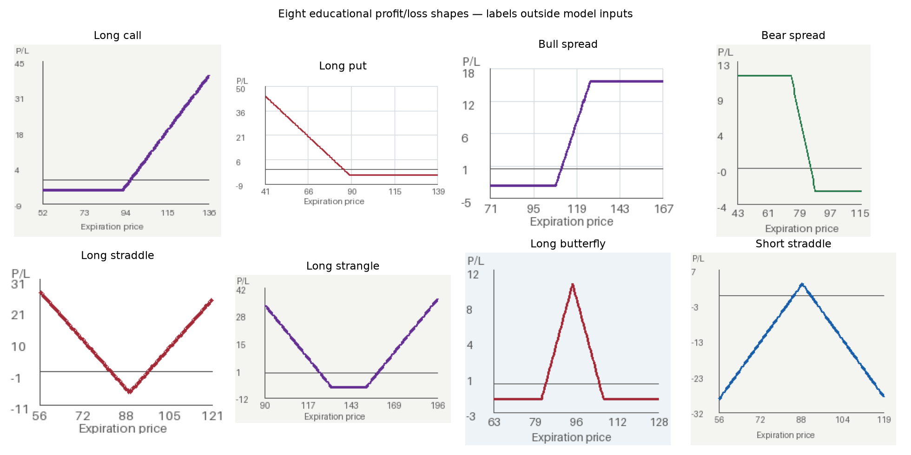

# Options Payoff Reader

An educational image classifier for eight options profit/loss shapes at expiration. Research question: **Can a compact image classifier recognize options payoff shapes across variations in chart formatting, and which design choices make it more reliable?**

## What it Does

Upload a chart or choose an example to get a predicted shape, confidence and a short explanation. Supported categories are long call, long put, bull spread, bear spread, long straddle, long strangle, long butterfly and short straddle. The tool recognizes shape categories rather than unique portfolios: different positions can produce equivalent diagrams. It uses synthetic training data and is not a trading recommendation system. Confidence is uncalibrated; unfamiliar or incomplete charts can produce confident errors.



## Quick Start

```sh
source .venv/bin/activate
python -m src.app
```

Open http://127.0.0.1:5001. These commands assume the local environment and trained artifacts are present. **For a clean clone, follow [SETUP.md](SETUP.md)** to install dependencies, generate data and train models. No API keys or global package changes are required.

## Video Links

Recordings are pending. No videos have been recorded or submitted yet.

- [Demo outline, 3-5 minutes](videos/DEMO_SCRIPT.md)
- [Technical walkthrough outline, 5-10 minutes](videos/TECHNICAL_SCRIPT.md)

Replace these pending entries with direct video links after recording; outlines do not satisfy the video requirement.

## Evaluation

The validation-selected compact CNN was trained on **12,000 images**, with separate 1,600-image validation and test sets. Actual seed-386 results:

| Evaluation set | Accuracy |
|---|---:|
| Standard synthetic test (1,600) | 100.0% |
| Unfamiliar styles (800) | 39.875% |
| Independent Matplotlib renderer (80) | 88.75% |

Standard macro-F1 is 1.000 and log loss is 0.000343. Balanced accuracy equals accuracy on these balanced sets. The checkpoint is 0.164 MB; median CPU inference including preprocessing is about 0.31 ms (batch one, four torch threads, 10 warmups, 50 measurements; excludes loading/decoding). These timings are environment-specific.

**Main finding:** familiar synthetic accuracy is easy to saturate and does not imply formatting robustness. The selected model failed all 400 dark-background charts. Frozen MobileNet features reached 84.875% on unfamiliar styles but required a larger model and slower inference. The original validation-selected model remains fixed; test results were not used for retuning.

See [experiment tables and curves](docs/RESULTS.md), [failure analysis](docs/ERROR_ANALYSIS.md), [data/model methodology and research references](docs/METHODOLOGY.md), and [validation record](docs/VALIDATION.md). This project is narrower than ChartQA-style chart reasoning and does not reproduce published research benchmarks.

## Individual Contributions

Riley Cusick is working individually. The project scope and experimental requirements were supplied by Riley. Codex generated implementation and documentation and executed experiments; see [ATTRIBUTION.md](ATTRIBUTION.md). The repository was already public when inspected; no visibility changes were made.
