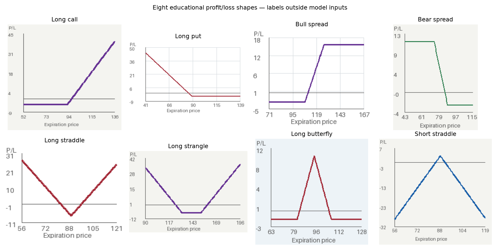

# Options Payoff Reader

A local educational tool that recognizes eight options profit/loss shapes and estimates values from chart images. It combines a trained image classifier, curve fitting, and local text recognition to handle varied chart formats.

## What it Does

Upload a PNG, JPEG, or WebP chart, or choose an example, to get a suggested payoff shape and an explanation. The reader supports long calls, long puts, bull spreads, bear spreads, long straddles, long strangles, long butterflies, and short straddles. When the image provides enough evidence, it estimates strikes, breakeven prices, maximum profit, and maximum loss. You can identify whether the vertical axis includes premium and confirm unreadable axis ticks by clicking the uploaded image. Different portfolios can produce the same shape, so these are shape categories rather than unique portfolio identifications. Numerical readings are approximate, and missing or unverifiable values are withheld. Images stay on your computer; no paid API or cloud service is used.

## Quick Start

From the repository root, with Python 3.12 installed:

```sh
python3.12 -m venv .venv
source .venv/bin/activate
python -m pip install -r requirements.txt
python -m pip install -c requirements.txt -r requirements-ocr.txt
python -m src.app
```

Open **http://127.0.0.1:5001**. The selected 1.3 MB checkpoint is included; retraining is optional. If the project environment is already installed, activate it and run the last command. See [SETUP.md](SETUP.md) for Apple Vision setup on macOS, training reproduction, and the public-chart audit commands. The optional OCR package includes local model weights. Confirmed-axis measurement can also work without OCR.



## Video Links

**Recordings are pending.** Add direct links to the finished recordings in this table before submission. The linked scripts are preparation materials, not completed videos.

| Recording | Required length | Video | Recording script |
|---|---|---|---|
| Project demo: purpose and live use, with no code | 3-5 minutes | Pending: add direct recording link | [Demo script](videos/DEMO_SCRIPT.md) |
| Technical walkthrough: implementation, experiments, and design choices | 5-10 minutes | Pending: add direct recording link | [Technical script](videos/TECHNICAL_SCRIPT.md) |

## Evaluation

The current CNN was trained on **16,000 synthetic charts** across **50 style families**: ten themes combined with five layout treatments, with variation in plot position, fonts, dimensions, lines, grids, blur, and compression. Five additional style combinations were used for validation, and five different combinations were reserved for testing. Pen, pencil, and chalk strokes are simulated; real handwriting has not been validated.

| Check | System evaluated | Recorded result |
|---|---|---:|
| New familiar-style synthetic test, 1,600 images | Current CNN | 100% accuracy |
| New held-out-format synthetic test, 800 images | Current CNN | 100% accuracy |
| Previously inspected unfamiliar-style set, 800 images | Current CNN | 98.375%, versus 39.875% for the original selected CNN |
| OIC public diagrams, development check | Combined reader | 8/8 shapes correct |
| Fidelity public diagrams, development check | Combined reader | 6/6 shapes correct, with numerical estimates |
| ASX reserved-publisher check, long calls and puts only | Combined reader | 4/4 shapes correct |

For the six Fidelity examples, the chart type was explicitly identified as profit/loss; no numeric reference values or manual tick corrections were supplied. Maximum strike error was **0.14** and maximum breakeven error was **0.23** in price-axis units. A separate 24-chart numerical development audit supplied the known category to isolate measurement quality: 23 charts returned at least strike estimates, with maximum strike error **0.43**.

The original model's familiar synthetic score concealed substantial formatting failures. The subsequent rebuild broadened training, changed preprocessing and architecture, and added geometry and OCR paths. The older unfamiliar-style set and the OIC/Fidelity examples informed development; they are not untouched final benchmarks. The new synthetic tests still share a renderer and analytic equations with training, and the four ASX images cover only two classes. These results do not establish arbitrary-screenshot or real-handwriting accuracy. Confidence is uncalibrated, and unsupported images can still receive a suggested label.

See [current evidence and limitations](docs/PRODUCT_STATUS.md), [current CNN training results](docs/results/cnn_diverse.json), [Fidelity numerical audit](docs/results/fidelity_automatic_audit.json), and [ASX holdout audit](docs/results/asx_holdout_audit.json). The [original controlled comparisons](docs/RESULTS.md), [methodology](docs/METHODOLOGY.md), and [original error analysis](docs/ERROR_ANALYSIS.md) document the earlier experiments. Their model selection and timing results describe that earlier system.

## Individual Contributions

Riley Cusick is working individually and supplied the educational goal, eight categories, scope, and requests for broader formatting support and numerical extraction. Codex generated implementation and documentation and executed the recorded experiments. Detailed AI, software, data, and pretrained-model attribution is in [ATTRIBUTION.md](ATTRIBUTION.md).

## Project Map

| Area | Main files |
|---|---|
| Equations and chart generation | `src/payoffs.py`, `src/diverse.py`, `src/generate.py` |
| Models and training | `src/learning.py`, `src/train_diverse.py`, `src/train.py` |
| Shape and numerical reading | `src/predict.py`, `src/geometry_reader.py`, `src/measure.py`, `src/ocr.py`, `src/calibration.py` |
| Interface and checks | `src/app.py`, `src/webcharts.py`, `tests/` |

`models/runtime.json` selects the current reader. `models/selection.json` preserves the original experiment selection. Source-tracked public images are downloaded locally for evaluation and are excluded from training and Git.
