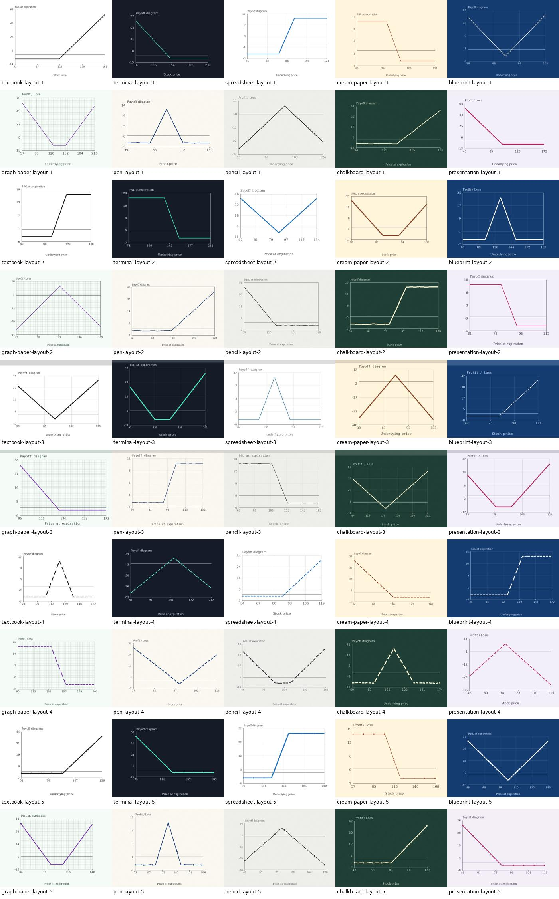

# Options Payoff Reader

A local educational tool for identifying options profit/loss shapes and reading values from chart images. The product goal is to handle everyday screenshots, textbook diagrams, and drawings across different formats. Unsupported and unreadable inputs remain active engineering work.

## Use it

```sh
source .venv/bin/activate
python -m src.app
```

Open http://127.0.0.1:5001. Upload a PNG, JPEG, or WebP image. The selected 1.3 MB checkpoint is included in the repository. For a clean clone, follow [SETUP.md](SETUP.md) to install dependencies; retraining is optional.

No paid APIs or cloud services are used. Uploaded images are processed in memory and stay on your computer. The portable OCR option is installed with `pip install -c requirements.txt -r requirements-ocr.txt`; its weights are bundled locally. Apple Vision is also supported on macOS. Shape classification and confirmed-axis reading can work without OCR.

## What the reader does

- Identifies eight shapes: long call, long put, bull spread, bear spread, long straddle, long strangle, long butterfly, and short straddle.
- Combines a CNN trained on 16,000 varied images with a reader that isolates a visible curve and fits its flats, slopes, and turning points.
- Estimates strikes, breakevens, maximum profit, and maximum loss when readable axes and curve geometry support them. Values are approximate, in the chart's units. It does not assume a contract multiplier or infer an unseen premium.
- Returns partial information when possible: for example, estimated strikes without profit/loss amounts when the vertical scale is missing.
- Shows the uploaded graph and lets you confirm two axis ticks when OCR cannot read them. Choose whether the vertical values include premium before interpreting profit/loss.

The curve identifies a shape, not a unique portfolio. Neural confidence is uncalibrated, and unsupported charts can still receive a suggested label. Numerical estimates are conditional on the suggested shape and a complete expiration curve.

## Format coverage

The new generator has **50 training families**: ten visual themes combined with five layout treatments, with randomized plot placement, dimensions, fonts, line widths, grids, compression, and blur. Themes include dark screens, textbook plots, graph paper, and simulated pen/pencil/chalk strokes. Ten additional layout/theme combinations are reserved for validation and test. These drawings are simulated; real handwriting photographs have not yet been validated.



## Measured progress

The new CNN achieved 100% on 1,600 new familiar-style test images and 800 held-out-format test images. On the original 800-image unfamiliar-style set, accuracy increased from **39.875% to 98.375%**. These are synthetic results, not arbitrary-upload accuracy.

The combined reader identified **8/8 public OIC diagrams** and **6/6 Fidelity diagrams** in development checks, including Fidelity's solid expiration curve alongside a dashed pre-expiration curve. On the six Fidelity examples, selecting profit/loss as the chart type produced automatic numerical estimates with maximum strike error **0.14** and maximum breakeven error **0.23** in price units. No ticks or reference values were supplied to those predictions. A reserved ASX publisher check identified **4/4** call/put diagrams; that small set covers only two shape classes.

The current numerical development audit recovered at least some values on **23/24 generated charts**, with maximum strike error **0.43 price units**. That audit supplies the known shape to isolate measurement quality. These small checks do not establish accuracy on arbitrary uploads. Missing or unverifiable values are withheld.

See [current capabilities and remaining work](docs/PRODUCT_STATUS.md), [training evidence](docs/results/cnn_diverse.json), and [web audit sources/results](docs/results/web_development_audit.json).

## Project map

`payoffs.py` defines analytic shapes; `diverse.py` generates multi-format images; `train_diverse.py` trains the CNN; `geometry_reader.py` isolates and classifies curves; `ocr.py` / `ocr.swift` read text locally; `measure.py` calibrates axes and estimates values; `predict.py` combines the readers; `app.py` provides the interface.

The original experiments remain in [RESULTS.md](docs/RESULTS.md), [METHODOLOGY.md](docs/METHODOLOGY.md), and [VALIDATION.md](docs/VALIDATION.md). `models/selection.json` preserves the original selection; `models/runtime.json` selects the practical reader.

Riley Cusick supplied the project scope and direction. Codex generated and tested implementation and documentation; see [ATTRIBUTION.md](ATTRIBUTION.md). Demo and technical recordings remain pending; outlines are under `videos/`.
