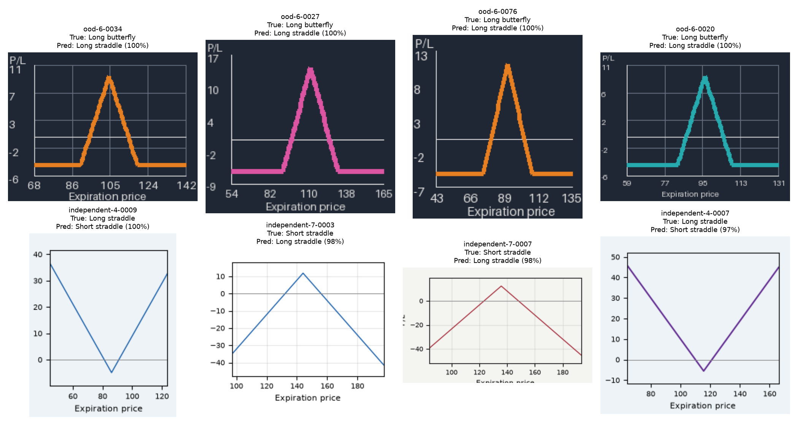
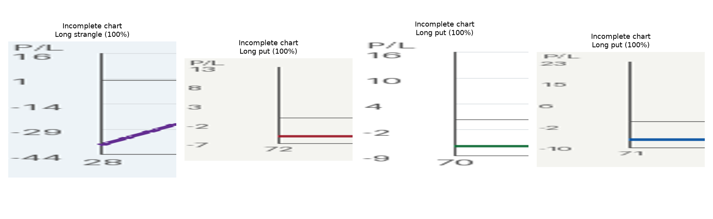

# Error analysis

The selected CNN recognizes familiar synthetic charts, but it does not reliably recognize all formatting variations. The standard test contains no errors (1,600/1,600); the unfamiliar-style set contains 481 errors (319/800 correct). Its 100% standard accuracy therefore overstates its usefulness for arbitrary uploads.

## Valid charts with unfamiliar styling

The first four panels are valid long butterflies with visible peaks and flat tails. The selected CNN calls them long straddles at confidence that rounds to 100%. All use a dark background absent from training. Across the full unfamiliar-style set, accuracy is 0/400 on dark charts and 319/400 (79.75%) on cream charts (results/ood_groups.json). This is strong evidence of style sensitivity. It is not a causal isolation of background: line colors and widths also change in this set. A paired rerender experiment would be needed to identify individual causes.

The remaining panels show valid Matplotlib charts. Examples independent-4-0009 and independent-4-0007 are V-shaped long straddles predicted as short straddles; independent-7-0003 and independent-7-0007 show the reverse mistake. Borders, font, line antialiasing and tick placement differ from Pillow. The geometry remains visible, so these are model errors rather than unanswerable inputs. Some Matplotlib axis labels are clipped at the figure boundary; the full plotted curve remains present. This variation is disclosed rather than silently fixing evaluation images after testing.

The selected model gets 71/80 independent charts correct. Long straddle and short straddle each have recall 0.70 on this small set; other class recalls and full confusion matrices are in results/evaluation.json. Ten examples per class is a limited diagnostic sample, not a robust real-world benchmark.

## What the controlled comparisons suggest

Brightness/contrast augmentation changes unfamiliar-style accuracy from 40.125% to 41.625% (+1.5 percentage points). It does not expose the model to a dark canvas with bright foreground strokes, so it is unsurprising that modest brightness scaling does not solve that shift. This mechanism is an interpretation, not a measured feature attribution.

Cropping improves independent-renderer accuracy from 91.25% for the reference full-color CNN to 98.75% for cropped color; grayscale full-image accuracy is 83.75%, and cropped grayscale is 97.5%. These comparisons suggest peripheral rendering differences matter. The crop retains some axes/grid and changes spatial scaling, so it cannot isolate text alone. On unfamiliar styles, all four ablation runs remain weak (36.875%-44.125%).

Frozen MobileNet features reach 84.875% unfamiliar-style accuracy, substantially better than these CNNs, while the stored-pixel baseline reaches 54.5%. The pretrained model is larger and slower and has access to ImageNet pretraining. Its generalization is evidence for that approach under this experiment, not a fair compute-matched architecture ranking.

## Incomplete charts and confidence

These charts intentionally lose most of the plot. A flat fragment or a single wing does not identify the full strategy. The system nevertheless returns a label, sometimes with confidence rounded to 100%. We do not score these against the source label because cropping removed the evidence needed to answer. Thirty of the 40 incomplete charts received confidence above 95% (results/ambiguous.json). There is no trained rejection or out-of-distribution detector. Confidence thresholds would not automatically fix these failures.

## Selection limitation and next experiment

All candidate validation accuracies tie at 100%. The locked size tie-break chooses cnn_lr_low. All CNNs actually have the same parameter count; tiny serialized-file differences are filename/archive overhead, not meaningful differences in model complexity. The rule clearly favors a small CNN over the 36.96 MB baseline, but it does not meaningfully distinguish CNN configurations. We retain it to avoid changing the rule after observing tests.

A future iteration should predefine a training/validation style distribution that includes dark and light backgrounds and multiple renderers, use repeated seeds, and reserve a new untouched style test set. Choose among tied compact models using a meaningful validation criterion such as log loss and explicit simplicity preferences. The current unfamiliar-style data have already been inspected and must not be relabeled as a fresh final test. Real permission-cleared screenshots, wider strike layouts, multiple curves, and calibrated abstention remain future work; none were evaluated here.
