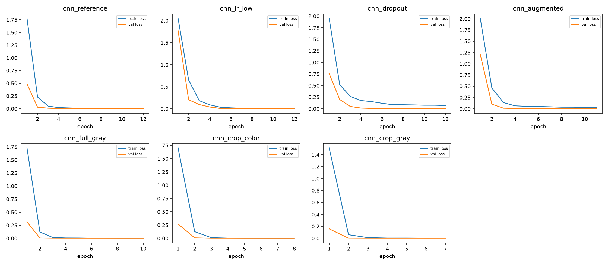
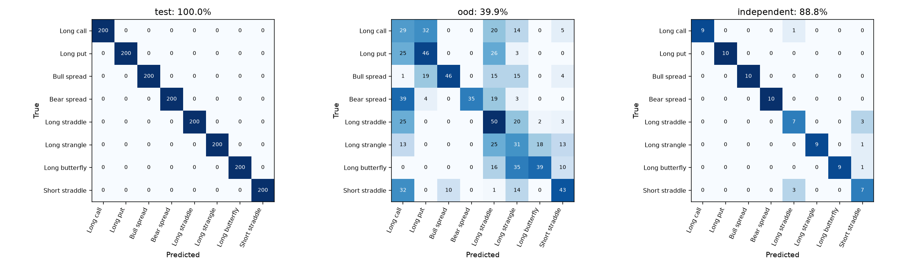

# Experiment results

Selected model: **cnn_lr_low**, chosen on validation before held-out evaluation. Results below are from actual runs, seed 386.

## Model comparison

| Run | Val accuracy | Test accuracy | Macro-F1 | Log loss | OOD accuracy | Independent renderer | Size MB | Median ms |
|---|---:|---:|---:|---:|---:|---:|---:|---:|
| baseline | 1.0000 | 1.0000 | 1.0000 | 0.000000 | 0.5450 | 1.0000 | 36.961 | 3.81 |
| cnn_reference | 1.0000 | 1.0000 | 1.0000 | 0.000112 | 0.4012 | 0.9125 | 0.164 | 0.31 |
| cnn_lr_low | 1.0000 | 1.0000 | 1.0000 | 0.000343 | 0.3987 | 0.8875 | 0.164 | 0.31 |
| cnn_dropout | 1.0000 | 1.0000 | 1.0000 | 0.000200 | 0.4062 | 0.9000 | 0.164 | 0.31 |
| cnn_augmented | 1.0000 | 1.0000 | 1.0000 | 0.000228 | 0.4163 | 0.9500 | 0.164 | 0.31 |
| cnn_full_gray | 1.0000 | 1.0000 | 1.0000 | 0.000051 | 0.3688 | 0.8375 | 0.164 | 0.32 |
| cnn_crop_color | 1.0000 | 1.0000 | 1.0000 | 0.000051 | 0.4412 | 0.9875 | 0.164 | 0.28 |
| cnn_crop_gray | 1.0000 | 1.0000 | 1.0000 | 0.000131 | 0.4225 | 0.9750 | 0.164 | 0.29 |
| transfer | 1.0000 | 0.9994 | 0.9994 | 0.003722 | 0.8488 | 0.8625 | 3.859 | 35.21 |

Accuracy and balanced accuracy are identical here because classes have equal support. Log loss provides a distinct probability-sensitive metric. All latency results use CPU, batch one, four torch threads, 10 warmups, 50 timed calls; preprocessing included, decoding/loading excluded. Full per-class metrics, p95 and platform are in results/evaluation.json.

## Hyperparameter tuning

| Run | Learning rate | Dropout | Selected epoch | Epochs run | Validation loss |
|---|---:|---:|---:|---:|---:|
| cnn_reference | 0.003 | 0.2 | 9 | 12 | 0.000123 |
| cnn_lr_low | 0.001 | 0.2 | 10 | 12 | 0.000307 |
| cnn_dropout | 0.003 | 0.4 | 11 | 12 | 0.000149 |

## Augmentation impact

| Run | Validation accuracy | Test accuracy | OOD accuracy |
|---|---:|---:|---:|
| cnn_reference | 1.0000 | 1.0000 | 0.4012 |
| cnn_augmented | 1.0000 | 1.0000 | 0.4163 |

Brightness/contrast augmentation changed OOD accuracy by +1.50 percentage points in this single-seed comparison. A change is evidence of impact, not proof of a repeatable improvement. No held-out result was used to retune.

## Two by two preprocessing ablation

| Input region | Channels | Run | Val accuracy | Test accuracy | OOD accuracy |
|---|---|---|---:|---:|---:|
| Full | Color | cnn_reference | 1.0000 | 1.0000 | 0.4012 |
| Full | Grayscale | cnn_full_gray | 1.0000 | 1.0000 | 0.3688 |
| Plot box | Color | cnn_crop_color | 1.0000 | 1.0000 | 0.4412 |
| Plot box | Grayscale | cnn_crop_gray | 1.0000 | 1.0000 | 0.4225 |

These four runs use the reference learning rate/dropout, seed and maximum epoch budget, with no augmentation. Early stopping can change actual epochs. The fixed crop removes peripheral labels but keeps axes/grid; this is not learned plot detection. The same reference run serves as the explicitly shared control.

## Selection and technical tradeoff

The predeclared rule selected cnn_lr_low at validation accuracy 1.0000. Among tied validation scores, checkpoint size broke the tie. It uses 0.164 MB versus 36.961 MB for the stored nearest-neighbor baseline. Measured median inference is 0.31 ms versus 3.81 ms for that baseline. The baseline stores training pixels and searches them; a CNN stores learned weights. These are concrete storage/latency tradeoffs, not a claim that neural models are always necessary.

The selected model's standard test accuracy is 100.00%, unfamiliar-style accuracy is 39.88%, and independent-renderer accuracy is 88.75%. These synthetic results do not establish performance on real screenshots. The transfer comparison uses ImageNet pretraining and 96px inputs; the CNN uses 64px. Equal labels/splits are controlled, but pretraining and resolution differ.

## Training curves

## Confusion matrices

